<div align="center">

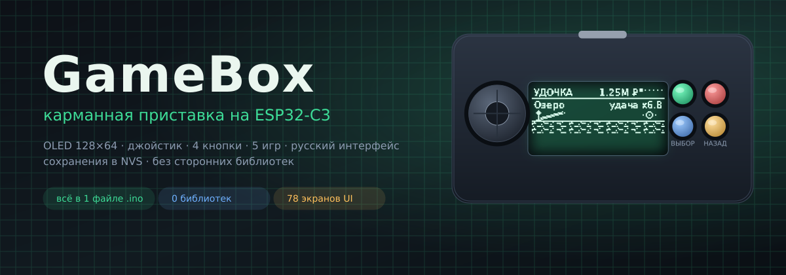

<br>


<b>Пять полноценных игр на плате размером с ноготь.</b><br>
Сохранения, прокачка, экономика, режимы — и всё это на экране 128×64,
где нет ни одного лишнего пикселя.

</div>

---

> **Это не демка «мигает светодиод».**
> Здесь пять законченных игр с прогрессом: рыбалка с 44 видами рыб и лодками,
> тренировочный симулятор с 106 зонами, Buckshot Roulette с дилером и предметами,
> RNG-крутилка с 48 аурами по вики Sol's RNG и клеточный автомат «Жизнь»
> с редактором поля. У каждой игры — своя вкладка справки прямо на приставке:
> забыть управление невозможно, подсказка всегда в двух нажатиях.

<div align="center">
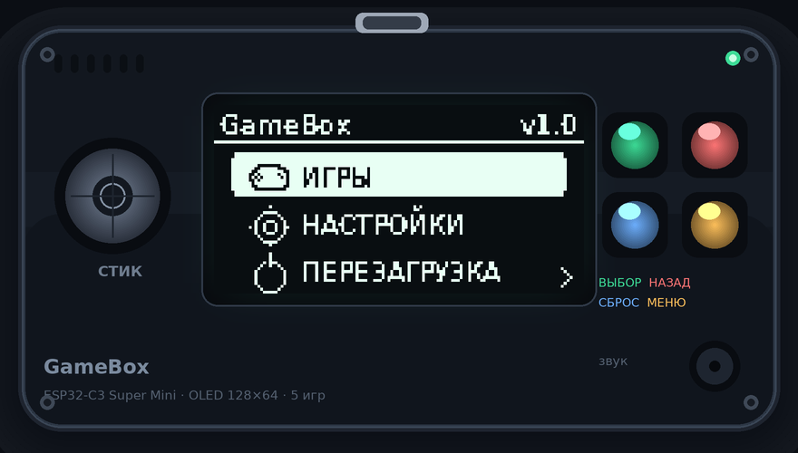
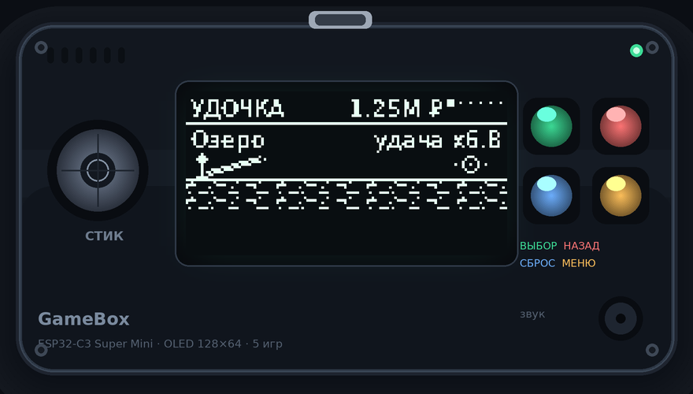
</div>

<div align="center"><sub>👆 Это не рендер «в фотошопе»: на экране каждого макета — настоящий кадр 128×64 из симулятора прошивки.</sub></div>

---

## Содержание

| Раздел | О чём |
| --- | --- |
| [Что умеет](#что-умеет) | пять игр, коротко и по делу |
| [Как это выглядит](#как-это-выглядит) | анимации интерфейса и все экраны |
| [Gameplay](#gameplay) | скриншоты каждой игры по разделам |
| [Повторить приставку](#повторить-приставку) | детали, схема, пайка, прошивка |
| [Управление](#управление) | что делают стик и четыре кнопки |
| [Как это сделано](#как-это-сделано) | архитектура, код, шрифт, графика |
| [Проверка без платы](#проверка-без-платы) | симулятор и автотест вёрстки |

---

## Что умеет

<table>
<tr>
<td width="50%" valign="top">

<h3>🎣 Симулятор рыбалки</h3>
6 вкладок, 44 вида рыбы (38 авторских спрайтов + 6 новых), 16 зелий,
6 зон с пропусками, престиж до 5-го уровня.
Удочка и лодки прокачиваются <b>раздельно</b>: у лодок своя удача, и она
намеренно ограничена 75 % от удочки — в одной и той же зоне удочка всегда
ловит лучше, а лодки берут количеством. Табло с балансом, уловом и званиями
открывается <b>с любой страницы</b> кнопкой СБРОС.

</td>
<td width="50%" valign="top">

<h3>💪 SPTS — тренировка силы</h3>
106 зон, и у каждой — свой навык. Зона качает <b>только один</b> навык,
следующая зона требует уровень этого навыка (<code>2 + 4n + n²</code>) и даёт
<b>×2 к нему</b> (<code>2ⁿ</code>), как в оригинальной игре. Плюс арена (бой с ботом
по силе удара) и магазин множителей.

</td>
</tr>
<tr>
<td valign="top">

<h3>🔫 Buckshot Roulette</h3>
Три раунда, жизни 2/4/6, патроны по формуле автора,
предметы по два за раунд (сигареты, пила, лупа, пиво, наручники, аптечка…).
Дилер думает, помнит просмотренные патроны и сам пользуется предметами.
Все кадры — оригинальные, из архива автора игры.

</td>
<td valign="top">

<h3>🎰 RNG</h3>
Крутилка аур: 48 аур с точными шансами из вики Sol's RNG
(от <code>Common 1/2</code> до <code>Virtual 1/2 500 000</code>), 8 зелий с эффектами,
пять вкладок: крутка, коллекция, зелья, улучшения, итоги.

</td>
</tr>
<tr>
<td valign="top">

<h3>🌱 Игра «Жизнь»</h3>
Клеточный автомат Конвея: редактор поля стиком, зум, скорость,
пауза и панель с показателями (популяция, поколение, шаг, живые).
Рисуется по правилам с «тороидным» краем — мир не заканчивается.

</td>
<td valign="top">

<h3>🧩 И это ещё не всё</h3>
Загрузочный логотип со спиннером, карусель игр с обложками,
снап-скролл вкладок, всплывающие уведомления с чёрной каймой,
справка по управлению внутри консоли (с прокруткой длинного текста),
сохранение прогресса в NVS, калибровка джойстика.

</td>
</tr>
</table>

---

## Как это выглядит

<div align="center">
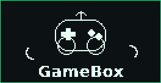
<br><sub>загрузка → главное меню → карусель игр (снап по одному экрану)</sub>
</div>

<br>

<table>
<tr>
<td align="center" width="50%">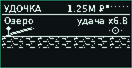<br><sub><b>Рыбалка</b>: заброс → поклёвка → улов → лодки → зелья → табло</sub></td>
<td align="center" width="50%">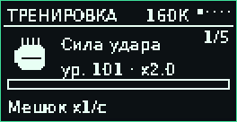<br><sub><b>SPTS</b>: тренировка → зоны → арена → результат боя</sub></td>
</tr>
<tr>
<td align="center">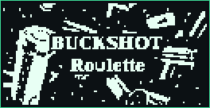<br><sub><b>Buckshot</b>: интро → раунд → стол → предметы → выстрел</sub></td>
<td align="center">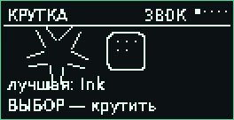<br><sub><b>RNG</b>: крутка → анимация → результат → коллекция → зелья</sub></td>
</tr>
</table>

<div align="center">
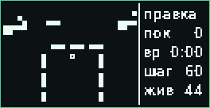
<br><sub><b>Игра «Жизнь»</b>: редактор → симуляция → пауза</sub>
</div>

<div align="center">
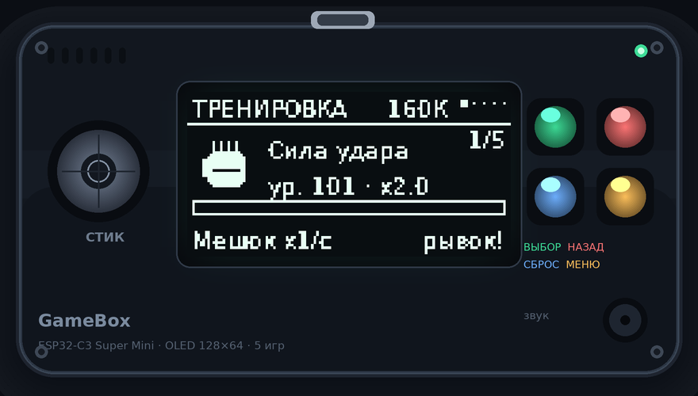
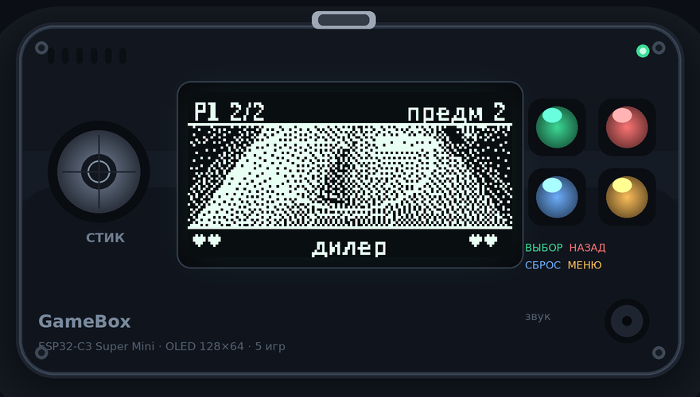
</div>
<div align="center">
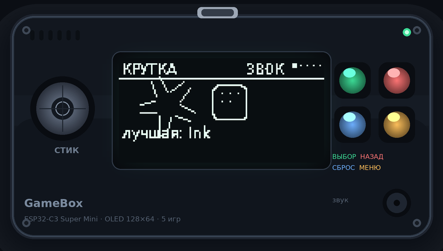
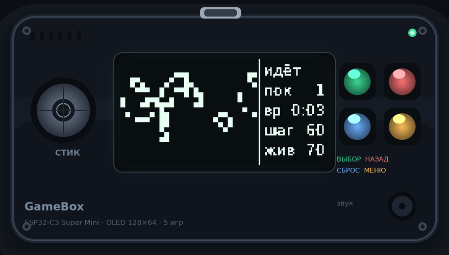
</div>

<div align="center">
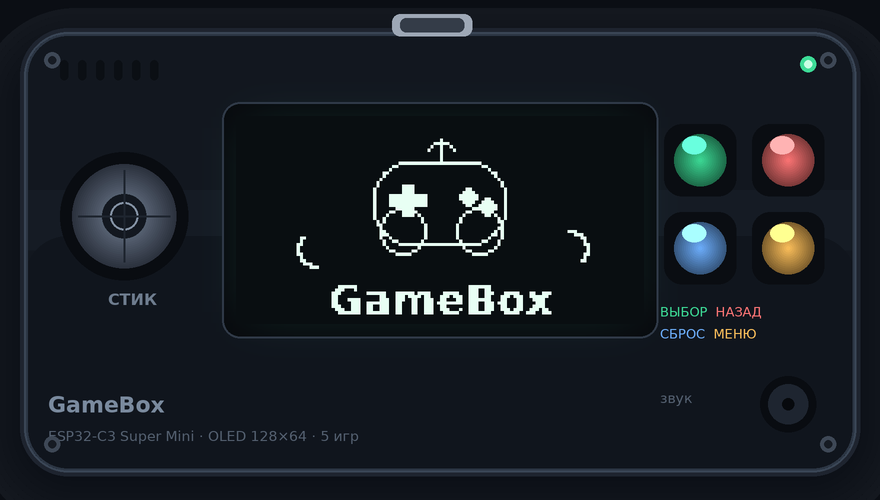
</div>

---

## Gameplay

### 🎣 Рыбалка

| | |
| --- | --- |
| 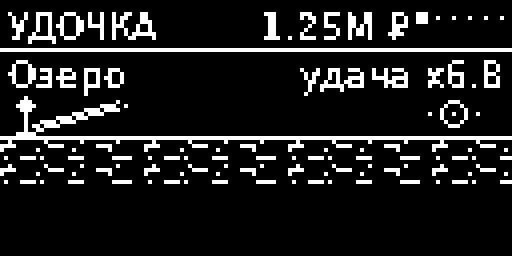 |  |
| **Заход в игру** — арт автора и первые подсказки | **Удочка** — заброс, рекорд, текущая удача |
| 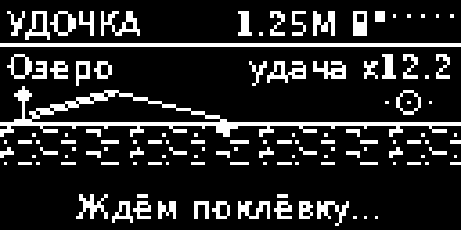 | 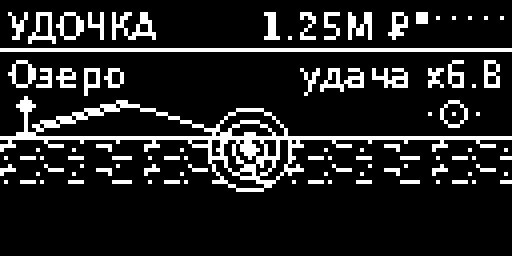 |
| **Поплавок летит** — анимация заброса | **Поклёвка** — нужно успеть нажать ВЫБОР |
| 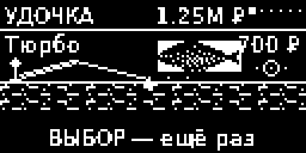 | 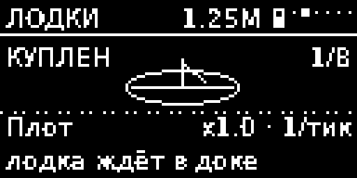 |
| **Улов** — вид, вес и цена всплывают над водой | **Лодки** — автолов: своя удача, свой доход |
| 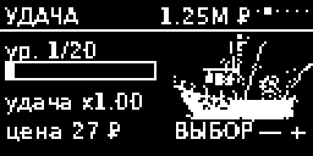 | 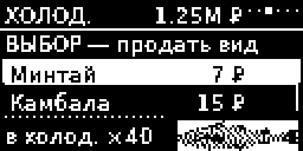 |
| **Удача лодок** — отдельная прокачка, 20 уровней | **Холодильник** — продать вид или сразу всё |
| 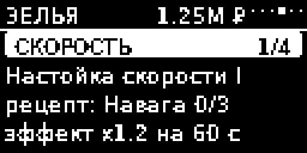 | 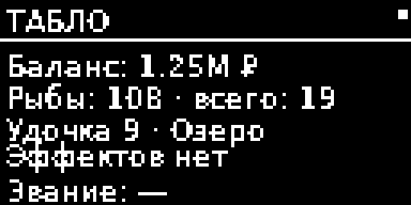 |
| **Зелья** — 16 штук, сгруппированы по категориям | **Табло** — баланс, улов, эффекты, звание (кнопка СБРОС) |
| 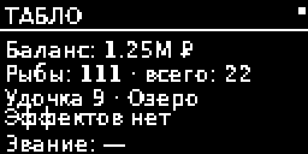 |  |
| **Зоны** — 6 локаций, открываются пропусками | **Престиж** — сброс ради ×1.5 к продаже и +10 % к удаче за уровень |

### 💪 SPTS

| | |
| --- | --- |
| 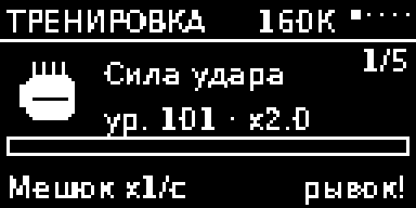 | 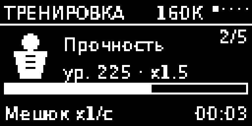 |
| **Тренировка** — тапай ВЫБОР, копится сила удара | **Уведомления** — белый текст с чёрной каймой, без плашки |
| 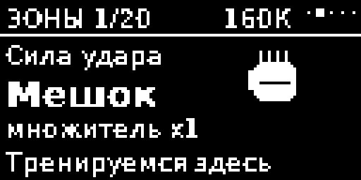 | 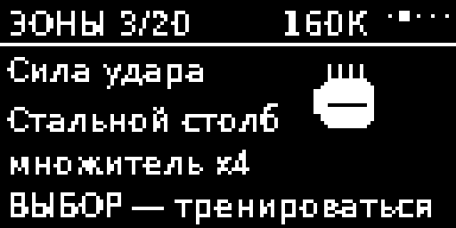 |
| **Зоны** — список на 106 позиций, снап-скролл | **Зона** — какой навык качает и во сколько раз |
| 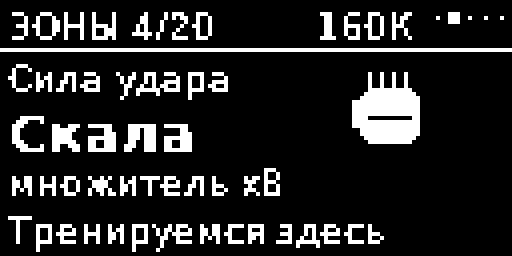 | 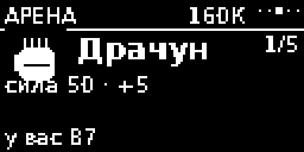 |
| **Арена** — бой по силе удара | **Магазин** — множители за очки |

### 🔫 Buckshot Roulette

| | |
| --- | --- |
| 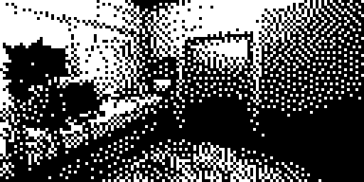 | 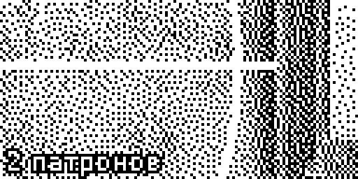 |
| **Интро** — кадры автора, ванная и «Get up…» | **Раунд** — сколько холостых и боевых в стволе |
| 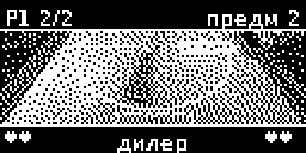 | 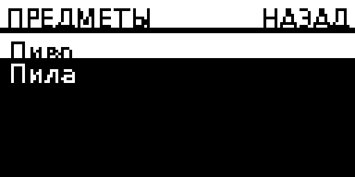 |
| **Стол** — дилер, жизни, ствол в кадре | **Предметы** — своё меню на весь экран |
|  | 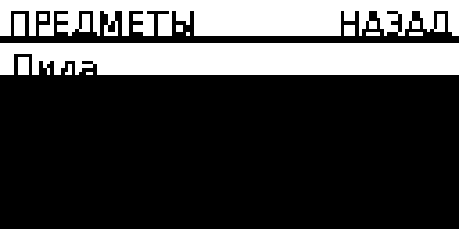 |
| **Выстрел** — кадр на весь экран | **Итог раунда** — кто выжил и что дальше |

### 🎰 RNG

| | |
| --- | --- |
| 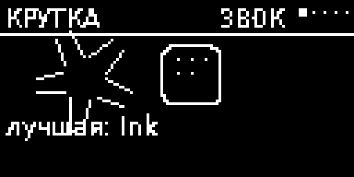 | 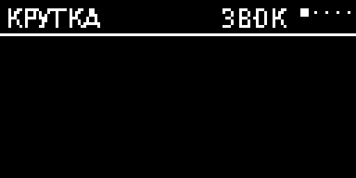 |
| **Крутка** — шанс и кнопка | **Анимация** — рулетка из аур |
| 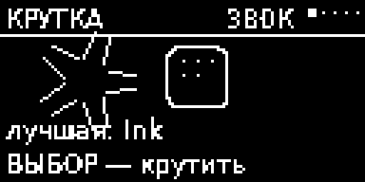 | 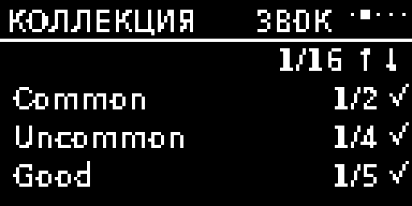 |
| **Результат** — аура, редкость, «1 из N» | **Коллекция** — что уже выпало (1/48) |
| 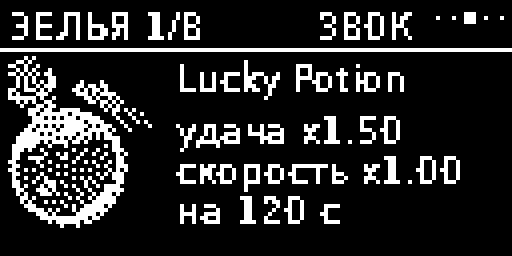 | 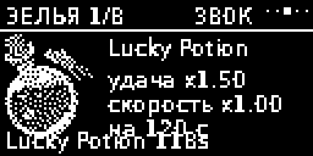 |
| **Зелья** — 8 штук, эффект и длительность | **Улучшения** — удача и скорость крутки |

### 🌱 Игра «Жизнь»

| | |
| --- | --- |
| 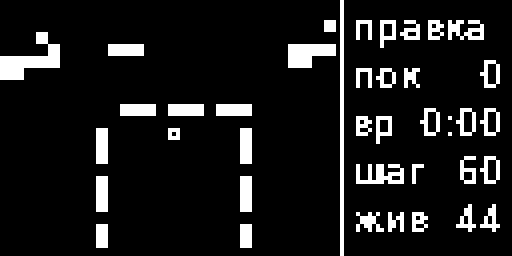 | 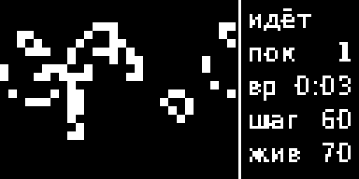 |
| **Редактор** — ставим клетки стиком | **Симуляция** — поколения, популяция, пауза |

<div align="center">
<a href="preview/all_screens.png">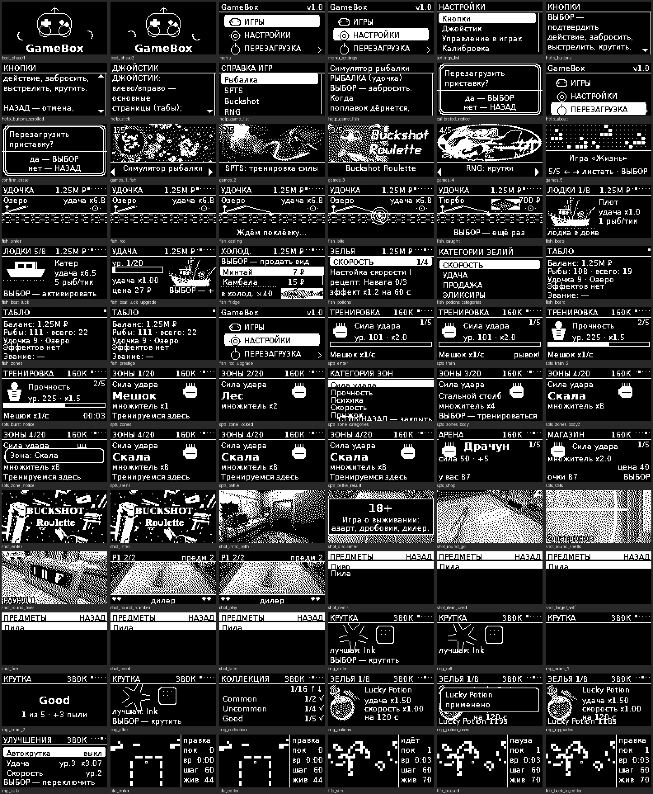</a>
<br><sub>👆 <b>Все 78 экранов приставки одной картинкой</b> (кликабельно)</sub>
</div>

---

## Повторить приставку

Собрать может кто угодно с паяльником и USB-кабелем: **пять деталей, десять проводов,
полчаса времени**. Ни одной сторонней библиотеки подключать не нужно —
драйвер экрана, шрифт и вся графика лежат внутри проекта.

### Что купить

| Деталь | Что именно | Зачем |
| --- | --- | --- |
| **ESP32-C3 Super Mini** | 4 МБ flash, USB-C, ~2×3 см | «мозг»: хватает и на игры, и на сохранения |
| **OLED SSD1306 128×64** | I2C, 4 pin (VCC/GND/SDA/SCL), адрес **0x3C** | экран приставки |
| **Джойстик KY-023** | два потенциометра + кнопка | навигация, ползунки, редактор поля |
| **4 тактовые кнопки** | любые, 6×6 мм | ВЫБОР / НАЗАД / СБРОС / МЕНЮ |
| **Пьезо-излучатель** | опционально | звук (можно жить и без него) |
| Провода, макетка | Dupont «мама-мама» | собрать без пайки за 10 минут |

> ⚠️ **Про экраны 1.3″.** Иногда под маркой SSD1306 продают SH1106 —
> у него 132 колонки и другая инициализация. Если картинка «съезжает» на 2 пикселя
> или не загорается, посмотрите `config.h`: там переключатель контроллера.

### Схема подключения

<div align="center">

</div>

```
OLED   VCC→3V3  GND→G   SDA→GPIO8  SCL→GPIO9
Стик   VCC→3V3  GND→G   VRx→GPIO0  VRy→GPIO1  SW→GPIO3
Кнопки ВЫБОР→GPIO4  НАЗАД→GPIO5  СБРОС→GPIO6  МЕНЮ→GPIO7
Пьезо  +→GPIO10  −→G
```

<div align="center">
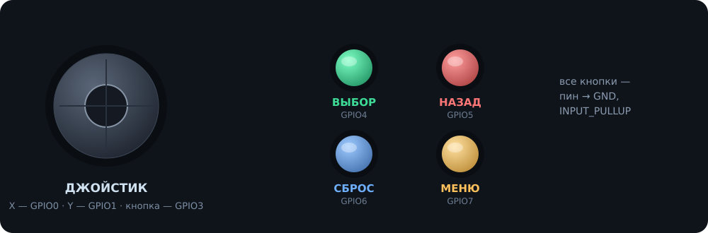
</div>

Все кнопки работают по схеме **«пин → GND»** с внутренней подтяжкой
(`INPUT_PULLUP`), нажатие = LOW. Резисторы и конденсаторы не нужны.
Логика 3.3 В: **5 В на пины не подавать**, `5V` с платы в этой сборке не используется.
Провода I2C держите покороче (10–15 см) — так картинка стабильнее.

### Прошивка

1. **Arduino IDE 2.x** → *Файл → Настройки → Дополнительные ссылки для менеджера плат*:
   ```
   https://raw.githubusercontent.com/espressif/arduino-esp32/gh-pages/package_esp32_index.json
   ```
2. *Инструменты → Плата → esp32* → установить ядро **esp32 by Espressif 2.0.14+**
   (нужен `analogReadMilliVolts`).
3. Выбрать плату **ESP32C3 Dev Module** и настройки:

   | Параметр | Значение |
   | --- | --- |
   | Flash size | **4 MB** |
   | Partition scheme | **Default 4MB with spiffs** |
   | USB CDC On Boot | **Enabled** (иначе не увидите Serial) |
   | CPU Frequency | 160 MHz |
   | Upload Speed | 921600 |

4. Открыть **`GameBox/GameBox.ino`** → «Загрузить».
5. Плата не видна в портах? Зажать **BOOT**, воткнуть USB, отпустить — и загружать снова.

Сторонние библиотеки **не требуются**. Adafruit GFX/SSD1306 можно не удалять —
проект их просто не использует.

### Первое включение

| Что происходит | Что делать |
| --- | --- |
| Логотип и спиннер | подождать пару секунд |
| Меню: ИГРЫ / НАСТРОЙКИ / ПЕРЕЗАГРУЗКА | стик вверх-вниз, ВЫБОР |
| Просит калибровку стика | отпустить стик и нажать ВЫБОР |
| Справка по кнопкам | читается сразу, длинный текст листается стиком |

Настройки → **Кнопки / Джойстик / Управление в играх / Калибровка** —
всё, что нужно, если стик шумит или кнопки нажаты «не туда».
Сохранения пишутся в NVS (`namespace gamebox`) автоматически, `SAVE_VERSION 3`;
пункт **СТЕРЕТЬ ПРОГРЕСС** в настройках всё обнуляет.

### Если что-то не так

| Симптом | Причина и лечение |
| --- | --- |
| Экран чёрный, I2C молчит | перепутаны SDA/SCL, адрес не 0x3C — пройтись сканером I2C |
| Картинка сдвинута на 2 px | это SH1106, а не SSD1306 — переключить в `config.h` |
| Стик «уезжает» сам | Настройки → Калибровка (порог 1100/350 мВ) |
| Кнопка срабатывает дважды | кнопка без фиксации: держите до щелчка, антидребезг 18 мс |
| Не грузится скетч | зажать BOOT при подключении; кабель — только data, не charge-only |
| Нет звука | пьезо не подключён или `USE_BUZZER 0` в `config.h` |

---

## Управление

| | Стик | ВЫБОР | НАЗАД | СБРОС | МЕНЮ |
| --- | --- | --- | --- | --- | --- |
| **Меню** | выбор пункта / карусель | войти | назад | — | перезагрузка из меню |
| **В игре** | вкладки, списки, ползунки | действие | назад | доп. действие игры | выход в меню |
| **Рыбалка** | вкладки | заброс / продать / купить | назад | **табло** (с любой страницы) | меню |
| **SPTS** | зоны и категории | тренировка / бой | назад | — | меню |
| **Buckshot** | выбор в меню предметов | выстрел | назад | новая партия | меню |
| **RNG** | вкладки | крутить | назад | — | меню |
| **Жизнь** | ставить клетки / скорость | старт / пауза | назад | очистить поле | меню |

Полная версия — [`docs/controls.md`](docs/controls.md).
Стик имеет порог и гистерезис: шаг засчитывается только после возврата в центр,
так что промахнуться «на два пункта» невозможно.

---

## Как это сделано

```
GameBox/
├── GameBox.ino              setup() + loop(), 20 строк
├── src/core/                ядро приставки
│   ├── config.h             все пины и константы в одном месте
│   ├── canvas.h/.cpp        кадровый буфер 128×64: текст UTF-8, блиты, примитивы
│   ├── font_data.h/.cpp     шрифт DejaVu, 1 бит на пиксель, 193 глифа
│   ├── oled.h/.cpp          собственный драйвер SSD1306 по I2C
│   ├── input.h/.cpp         джойстик с порогом/гистерезисом, антидребезг
│   ├── storage.h/.cpp       обёртка NVS (Preferences) + версия сохранений
│   ├── ui.h/.cpp            шапка, прогресс, баннеры, скроллбар, блики
│   ├── game.h               базовый класс игры: вкладки, страницы, модальность
│   ├── host.h/.cpp          загрузка игры, анимации переходов
│   └── app.h/.cpp           загрузка, меню, карусель, настройки, справка
├── src/games/               пять игр, каждая в своём .cpp
├── src/gfx/                 1-битная графика: моя + автора
├── tools/                   генераторы шрифтов, графики, схемы, симулятор
├── docs/                    прошивка, схема, управление, картинки для README
└── preview/                 78 кадров экрана + контактный лист
```

Несколько решений, которыми проект и получился:

* **Никаких библиотек.** Драйвер SSD1306 — 120 строк, шрифт — своя таблица
  глифов, графика — собственный `Canvas` с блитами и клиппингом. Прошивка
  собирается «из коробки», конфликтов версий не бывает.
* **Шрифт с кириллицей и ₽.** `tools/gen_fonts.py` берёт DejaVu, режет на
  глифы 5×9 и 8×13, упаковывает по 1 биту на пиксель — 193 глифа в 3.9 КБ flash.
  Знак рубля при отсутствии в шрифте синтезируется из «Р».
* **Вёрстка проверяется машинно.** Симулятор после каждого кадра сравнивает
  рамки всех надписей и печатает список наложений. Сейчас их **ноль** —
  поэтому текст нигде не залезает на иконки и не обрезается.
* **Кадры рисуются по 128×64-буферу, а не «по пикселям вручную»**:
  один и тот же код работает и на ESP32 (I2C), и на ПК (PNG для README).
* **Сохранения.** Один NVS-namespace `gamebox`, версия схемы `SAVE_VERSION 3`:
  при смене формата старые данные аккуратно игнорируются, прогресс не «ломает» игру.
* **Текст, который длиннее экрана**, верстается построчно в отдельный буфер
  и прокручивается с полосой и стрелками — любая справка читается до конца.

### Графика автора

Оригинальные исходники GameBox (Michail Smirnow, архив на Google Drive)
использованы напрямую: кадры Buckshot Roulette 128×64, спрайты рыб,
интерфейс рыбалки (холодильник, пиво, зелья, замок) и обложки меню.
Всё это лежит в `src/gfx/gfx_their.cpp`, собирается скриптом
`tools/gen_their_art.py` — PNG в репозитории не хранятся, только 1-битные массивы.
Мои собственные картинки (`src/gfx/gfx_data.cpp`) — только дополнение
к авторским, а не замена.

---

## Проверка без платы

В `tools/` есть симулятор: он собирает **весь код прошивки** на ПК,
прогоняет сценарий по всем играм и выгружает кадры 128×64 в PNG.

```bash
cd GameBox
python3 tools/gen_screens.py      # собрать и отрисовать все 78 экранов
python3 tools/gen_assets.py       # перерисовать мою графику
python3 tools/gen_their_art.py    # пересобрать графику автора из исходников
python3 tools/gen_diagram.py      # перерисовать схему подключения
python3 tools/gen_readme.py       # макеты приставки и анимации для README
```

Сборка ядра на хосте (без Arduino IDE):

```bash
g++ -std=c++17 -I GameBox/src/core -I GameBox/src -I GameBox/src/gfx \
    tools/sim/host_main.cpp GameBox/src/core/*.cpp \
    GameBox/src/games/*.cpp GameBox/src/gfx/*.cpp -o /tmp/gb \
 && /tmp/gb preview
```

Симулятор собирается и под санитайзеры (`-fsanitize=address,undefined`) —
на нём прогнаны десятки тысяч игровых событий во всех пяти играх:
без падений, утечек и UB.

---

## Документация

| Файл | Содержимое |
| --- | --- |
| [`docs/README.md`](docs/README.md) | сборка и прошивка шаг за шагом |
| [`docs/wiring.md`](docs/wiring.md) | таблица пинов, питание, ограничения |
| [`docs/wiring.svg`](docs/wiring.svg) / [`wiring.png`](docs/wiring.png) | схема подключения |
| [`docs/controls.md`](docs/controls.md) | управление: консоль и каждая игра |
| [`docs/img/`](docs/img/) | макеты приставки и GIF-демки для этого README |
| [`preview/all_screens.png`](preview/all_screens.png) | все 78 экранов одной картинкой |

---

## Лицензия и благодарности

* Код ядра и пять игр — этот репозиторий.
* Оригинальные графика и дизайн GameBox — **Michail Smirnow** (исходный проект на ESP8266),
  использованы с сохранением стиля и по просьбе «добавлять, а не заменять».
* Названия аур, зелий и их шансы — [Sol's RNG Wiki](https://sol-rng.fandom.com/).
* Зоны, навыки и множители SPTS — [Super Power Training Simulator](https://roblox-super-power-training-simulator.fandom.com/).
* Buckshot Roulette — дизайн Mike Klubnika; предметы и правила повторяют оригинал.
* Шрифт DejaVu Sans (Bitstream Vera license) через `tools/gen_fonts.py`.

<div align="center">


<b>Собрали? Покажите.</b> Форкните, добавьте шестую игру — каркас к этому готов:
наследуйтесь от <code>Game</code>, опишите вкладки и <code>draw()</code>, добавьте обложку 128×46.
</div>
