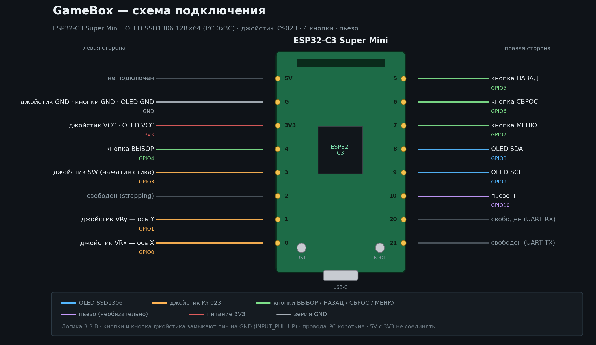

# GameBox — сборка и прошивка

Портативная приставка на **ESP32-C3 Super Mini**: экран OLED SSD1306 128×64 по I2C,
аналоговый джойстик KY-023, четыре кнопки и (необязательно) пьезо-излучатель.
Пять игр, русский интерфейс, сохранения в NVS.



## Что нужно

| Компонент | Примечание |
| --- | --- |
| ESP32-C3 Super Mini | 4 МБ flash, USB-C |
| OLED SSD1306 128×64, I2C | адрес 0x3C (при 1.3″ может быть SH1106 — см. `config.h`) |
| Джойстик KY-023 | два потенциометра + кнопка |
| 4 тактовые кнопки | любой размер, замыкание на GND |
| Пьезо-излучатель | по желанию, звук необязателен |
| Провода, макетная плата | Dupont «мама-мама» |

Ядро ESP32 в Arduino IDE: **esp32 by Espressif, версия 2.0.14 или новее** (нужен
`analogReadMilliVolts`). Библиотеки Adafruit и любые другие — не требуются.

## Подключение

Полная таблица — в [wiring.md](wiring.md), картинка выше — `docs/wiring.png`.

```
OLED  VCC→3V3  GND→G   SDA→GPIO8  SCL→GPIO9
Стик  VCC→3V3  GND→G   VRx→GPIO0  VRy→GPIO1  SW→GPIO3
Кнопки  ВЫБОР→GPIO4  НАЗАД→GPIO5  СБРОС→GPIO6  МЕНЮ→GPIO7
Пьезо   +→GPIO10  −→G
```

Все кнопки работают по схеме «пин → GND» с внутренней подтяжкой (`INPUT_PULLUP`),
нажатие = LOW. Питание — от USB-C.

## Прошивка

1. Arduino IDE → **Файл → Настройки → Дополнительные ссылки для менеджера плат**:
   `https://raw.githubusercontent.com/espressif/arduino-esp32/gh-pages/package_esp32_index.json`
2. **Инструменты → Плата → esp32 → ESP32C3 Dev Module**
3. Настройки платы:
   * Flash size — **4 MB**
   * Partition scheme — **Default 4MB with spiffs**
   * USB CDC On Boot — **Enabled** (иначе Serial не увидите)
   * CPU Frequency — 160 MHz, Upload speed — 921600
4. Открыть `GameBox/GameBox.ino` и нажать «Загрузить».
5. Если плата не определяется — зажать **BOOT**, воткнуть USB, отпустить.

Сторонние библиотеки **не нужны**: драйвер SSD1306, шрифт и графика написаны
внутри проекта (`GameBox/src/core/`). Библиотеки Adafruit (GFX / SSD1306) можно
держать установленными — код их не трогает и не требует.

## Структура проекта

```
GameBox/
├── GameBox.ino              setup() + loop()
└── src/
    ├── core/                ядро приставки
    │   ├── config.h         все пины и константы
    │   ├── canvas.h/.cpp    кадровый буфер 128×64, текст UTF-8, блиты, примитивы
    │   ├── font_data.h/.cpp шрифт (DejaVu, сгенерирован tools/gen_fonts.py)
    │   ├── oled.h/.cpp      драйвер SSD1306 по I2C (свой, без библиотек)
    │   ├── input.h/.cpp     джойстик с порогом/гистерезисом, антидребезг кнопок
    │   ├── storage.h/.cpp   обёртка над Preferences (NVS) + версия сохранений
    │   ├── ui.h/.cpp        общие элементы: шапка, прогресс, баннеры, скроллбар
    │   ├── game.h           базовый класс игры (вкладки, страницы, модальность)
    │   ├── host.h/.cpp      загрузка игры, анимации переходов
    │   └── app.h/.cpp       загрузка, меню, карусель игр, настройки, справка
    ├── games/               пять игр, каждая в своём .cpp
    └── gfx/                 1-битные картинки (gfx_data.cpp) и объявления
```

## Инструменты (на компьютере, не на плате)

| Скрипт | Что делает |
| --- | --- |
| `tools/gen_fonts.py` | собирает `font_data.*` из DejaVu, добавляет синтетический «₽» |
| `tools/gen_assets.py` | рисует всю 1-битную графику и пишет `gfx_data.cpp` + контактный лист |
| `tools/gen_diagram.py` | схема подключения `docs/wiring.png` |
| `tools/gen_screens.py` | сборка симулятора и экспорт экранов в `preview/` |
| `tools/sim/host_main.cpp` | симулятор: гоняет приставку на ПК и снимает кадры 128×64 |

Быстрая проверка без платы:

```bash
cd GameBox
g++ -std=c++17 -O1 -I GameBox/src/core -I GameBox/src \
    -o /tmp/gbsim tools/sim/host_main.cpp \
    GameBox/src/core/*.cpp GameBox/src/games/*.cpp GameBox/src/gfx/*.cpp
/tmp/gbsim /tmp/gbshots          # кадры в /tmp/gbshots (+ GB_TRACE=1 для трассировки)
```

Полный рендер всех экранов в PNG: `python3 tools/gen_screens.py`.

## Сохранения

Всё лежит в NVS (`Preferences`, namespace `gamebox`), ключи префиксованы по играм:
`fish_*`, `spts_*`, `shot_*`, `rng_*`, `life_*`, `cfg_*`. При смене формата
поднимайте `SAVE_VERSION` в `config.h`: несовпадение версий чистит сохранения игр.
«Настройки → Удалить все сохранения» стирает namespace целиком.

## Если что-то не так

| Симптом | Причина / решение |
| --- | --- |
| Экран белый или пустой | проверьте `GND`, `3V3`, `SDA/SCL`; адрес 0x3C; для 1.3″ раскомментируйте `DISPLAY_SH1106` в `config.h` |
| Пункты меню прыгают сами | джойстик не центрирован — «Настройки → Калибровка джойстика» |
| Не работает кнопка | кнопка должна замыкать пин на GND, второй вывод — на G |
| Плата не прошивается | зажать BOOT → вставить USB → отпустить; драйвер CH340/CP210x |
| Сохранения сбросились | изменился `SAVE_VERSION` или стирание из настроек |
